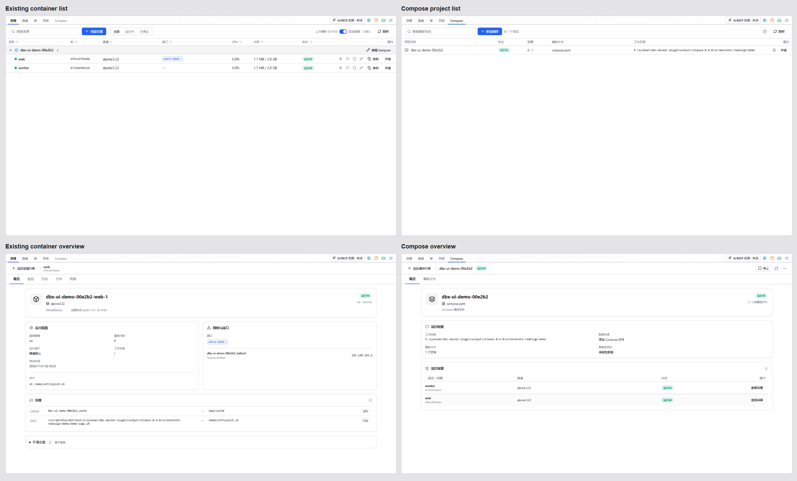
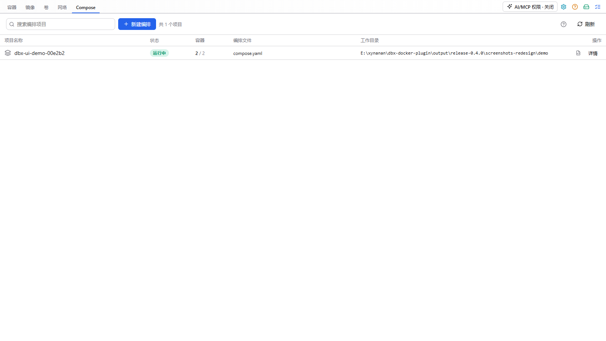
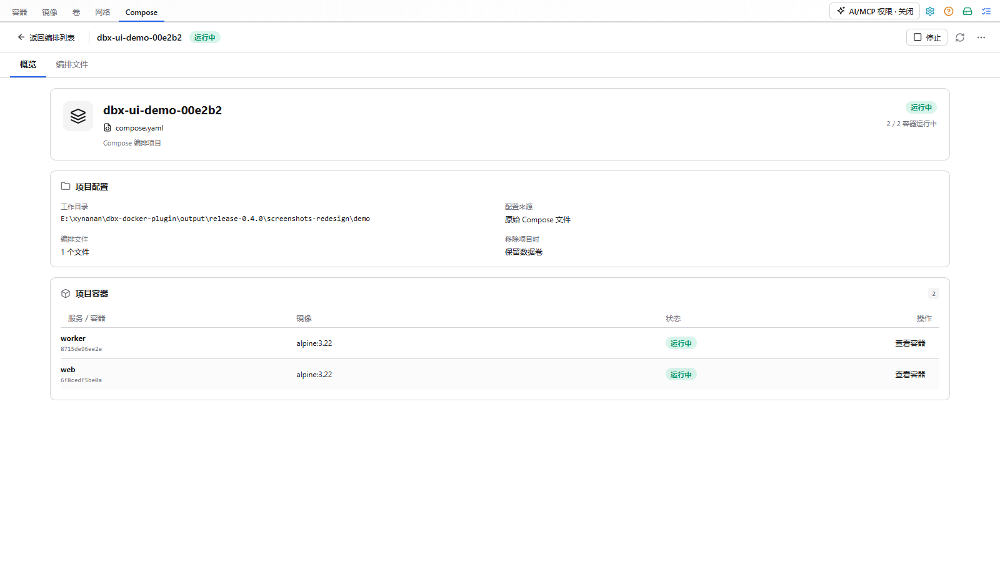
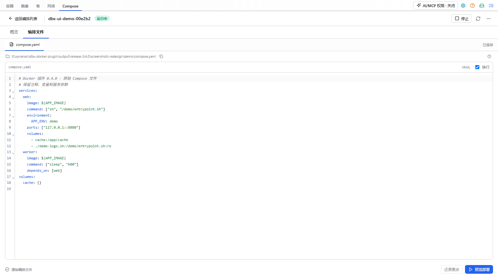
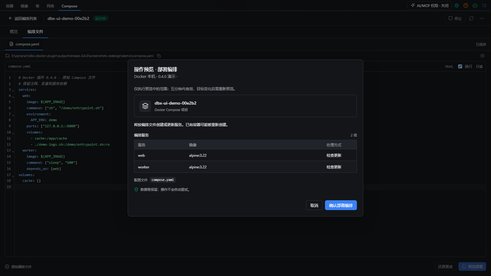

# Compose UI verification — 0.4.0 rebuild

Final result: **passed**. Scope: Compose only. Container copy and log wrapping retain the accepted UI and behavior.

## Reference and comparison

Reference: this plugin's existing container list and container overview, rendered at the same 1600×900 viewport, device scale 1. The new page reuses those components and tokens. Resource content differs; the comparison verifies component consistency rather than a pixel-identical clone.

The combined comparison was inspected for toolbar density, typography, border colors, status badges, spacing, card radius and detail navigation. Source editor, dark dialogs and compact viewport were inspected separately. No unresolved blocking visual issues were found.

## Implemented UI

- Project list: existing search/clear, primary creation button, compact table, explicit details/edit entries and help.
- Details: existing header and overview/file tabs, overview cards and links to existing container detail.
- Source: basename tabs, copyable path, highlighted editor filling remaining height, saved/dirty state and preview action.
- Confirmation: project, affected services/containers and images; exact project name required for removal. Long explanations live in help.
- Feedback: inline task progress/results, skeletons, empty state, retry and read-only state. Unsaved edits require confirmation before leaving.

## Interaction evidence

Headless Chromium, real production UI bundle, framed Go RPC and a disposable two-service Docker project. The harness supplies a minimal DBX bridge and filters screenshots to the demo project. Checked 1600×900 light/dark and 980×720 layouts; no body horizontal overflow in the compact source view.

Verified search empty/clear, discard cancellation preserving text, readable two-service deployment review, removal disabled for empty/wrong names and enabled only for the exact name, cancellation without deletion, real stop/start updating project and task state, missing source/retry/recovery, container detail navigation, read-only editor/deployment, and no page errors.

During iteration, fixed an automatically opening task modal, dark-theme transition screenshots and a reproduced stop/start preview rejection caused by transient Docker network teardown. Repeated the browser run successfully after those fixes; the separate live regression also executes deploy/edit/restart/remove/redeploy, checks retained volumes and refuses stale source/environment, replay and read-only writes.

Local evidence: `output/release-0.4.0/screenshots-redesign/capture-report.json`, `capture.mjs`, `compare.mjs` and the full screenshot set. This is automated browser verification; actual remote SSH Compose and manual DBX desktop acceptance were not performed in this rebuild.
